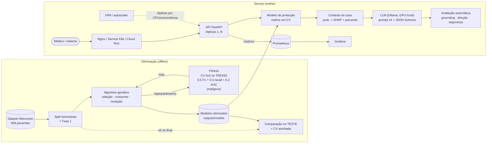

# Tech Challenge — Fase 2

**Autor:** Wesley Sardi (entrega individual)

Otimização dos modelos de diagnóstico de câncer de mama da [Fase 1](https://github.com/WesleySardi/TechChallenge_Fase1_POSTECH)
com **algoritmos genéticos** e interpretação dos resultados com **LLMs** (Projeto 1 do Tech Challenge):

1. **Algoritmo genético (GA)** implementado do zero para otimizar os hiperparâmetros dos 4 modelos da
   Fase 1 (Logistic Regression, Decision Tree, KNN, Random Forest): 4 configurações de experimento × 3
   seeds, comparação com busca aleatória e com os modelos originais (teste + validação cruzada aninhada).
   Como extra, o mesmo GA otimiza a CNN de transfer learning (ResNet18) na GPU.
2. **LLM local (Ollama — Qwen 2.5 7B e Llama 3.1 8B)** transforma a predição e os fatores SHAP em
   explicações para médicos e responde perguntas em linguagem natural, com 4 versões de prompt e
   avaliação automática de qualidade.
3. **API FastAPI** com métricas Prometheus, logs estruturados, dashboard Grafana, **escalabilidade
   automática** (Kubernetes HPA) e infraestrutura como código (Terraform) para o Google Cloud Run.

Veja o [Relatório Técnico completo](RELATORIO_TECNICO.md) para a discussão detalhada das decisões e
resultados, ou explore o [notebook de demonstração](notebooks/demo_fase2.ipynb) já executado — o GitHub
renderiza o notebook direto no navegador, com todas as figuras, sem precisar instalar nada.

## Resultados em destaque

**Algoritmo genético — comparação robusta (validação cruzada aninhada, 10 partições, fora da amostra):**

| Modelo | Métrica | Original (Fase 1) | Otimizado (GA) | Diferença |
|---|---|---|---|---|
| Random Forest | F1 (maligno) | 0.942 | **0.956** | +1.4 pt (p=0.047) |
| Random Forest | Recall (maligno) | 0.931 | **0.958** | +2.6 pt |
| Decision Tree | ROC-AUC | 0.924 | **0.963** | +3.8 pt (p=0.004) |
| Logistic Regression | F1 (maligno) | 0.965 | 0.963 | neutro |
| KNN | Precisão (maligno) | 0.983 | 0.958 | −2.5 pt |

O GA melhora os modelos com espaço de hiperparâmetros rico (árvores e florestas); nos modelos simples,
cujos defaults já eram bons, não há ganho — discussão completa no relatório.


**EXTRA — GA na CNN (ResNet18, CBIS-DDSM):** acurácia 0.659 → **0.697**, F1 0.573 → **0.613**,
ROC-AUC 0.719 → **0.744** no teste oficial.

**LLM (Qwen 2.5 7B + prompt v4):** classificação, probabilidade e direção dos fatores 100% corretas,
aviso de segurança em 100% das explicações e **nenhum número inventado** (~12 s por explicação na RTX 5070).


**Escalabilidade (Kubernetes HPA):** 2 → 10 réplicas em ~45 s sob carga e de volta a 2 após o pico,
sem nenhum erro (502 req/s no pico).


Tabelas completas em [`outputs/reports/`](outputs/reports/); todas as figuras em
[`outputs/figures/`](outputs/figures/).

## Onde encontrar cada requisito do Tech Challenge

Mapa entre os itens do enunciado (Projeto 1) e a implementação. Os links de código abrem o arquivo;
os de relatório abrem a seção correspondente do [Relatório Técnico](RELATORIO_TECNICO.md).

**1. Otimização via algoritmos genéticos**

| O que o PDF pede | Onde está no código | Relatório |
|---|---|---|
| Algoritmo genético para os hiperparâmetros dos modelos do Módulo 1 | [`src/ga/engine.py`](src/ga/engine.py), [`src/ga/search_spaces.py`](src/ga/search_spaces.py) | [§2](RELATORIO_TECNICO.md#2-algoritmo-genético) |
| Codificação dos hiperparâmetros (representação dos genes) | [`src/ga/genes.py`](src/ga/genes.py) | [§2.1](RELATORIO_TECNICO.md#21-codificação-representação-dos-genes) |
| Operadores de seleção, cruzamento e mutação | [`src/ga/operators.py`](src/ga/operators.py) | [§2.2](RELATORIO_TECNICO.md#22-operadores) |
| Função fitness baseada em métricas (accuracy, recall, F1...) | [`src/ga/fitness.py`](src/ga/fitness.py) | [§2.3](RELATORIO_TECNICO.md#23-função-fitness) |
| Comparar modelos otimizados com os originais | [`src/optimization.py`](src/optimization.py), [`main_nested_cv.py`](main_nested_cv.py) | [§3.2](RELATORIO_TECNICO.md#32-comparação-no-conjunto-de-teste-114-pacientes), [§3.3](RELATORIO_TECNICO.md#33-comparação-robusta-validação-cruzada-aninhada) |
| Pelo menos 3 experimentos com configurações diferentes do GA | [`src/optimization.py`](src/optimization.py), [`main_ga.py`](main_ga.py) | [§2.4](RELATORIO_TECNICO.md#24-experimentos), [§3.1](RELATORIO_TECNICO.md#31-fitness-em-validação-cruzada-treino) |
| (extra) GA na CNN de imagens | [`src/cnn_ga.py`](src/cnn_ga.py), [`main_ga_cnn.py`](main_ga_cnn.py) | [§3.4](RELATORIO_TECNICO.md#34-extra-ga-na-cnn-resnet18-transfer-learning) |

**2. Escalabilidade automática, monitoramento e logging**

| O que o PDF pede | Onde está no código | Relatório |
|---|---|---|
| Escalabilidade automática para variações de demanda | [`deploy/k8s/hpa.yaml`](deploy/k8s/hpa.yaml), [`docker-compose.yml`](docker-compose.yml), [`scripts/k8s_demo.sh`](scripts/k8s_demo.sh) | [§6.3](RELATORIO_TECNICO.md#63-escalabilidade-automática) |
| Monitoramento e logging para tracking de desempenho | [`src/api/metrics.py`](src/api/metrics.py), [`src/monitoring/logging_config.py`](src/monitoring/logging_config.py), [`deploy/prometheus/`](deploy/prometheus/), [`deploy/grafana/`](deploy/grafana/) | [§6.2](RELATORIO_TECNICO.md#62-monitoramento-e-logging) |
| Documentar arquitetura e decisões de implementação | [`README.md`](README.md#arquitetura) | [§6.3](RELATORIO_TECNICO.md#63-escalabilidade-automática), [§9](RELATORIO_TECNICO.md#9-desafios-enfrentados-e-soluções) |
| (opcional) Implementação em nuvem — planejada e codificada, não implantada | [`infra/terraform/`](infra/terraform/), [`scripts/deploy_gcp.sh`](scripts/deploy_gcp.sh) | [§7](RELATORIO_TECNICO.md#7-implementação-em-nuvem-bônus-google-cloud-run--terraform) |

**3. Integração com LLMs**

| O que o PDF pede | Onde está no código | Relatório |
|---|---|---|
| Integrar uma LLM pré-treinada | [`src/llm/client.py`](src/llm/client.py) | [§4.1](RELATORIO_TECNICO.md#41-escolha-do-modelo) |
| Explicações em linguagem natural dos diagnósticos | [`src/llm/explainer.py`](src/llm/explainer.py), [`src/api/app.py`](src/api/app.py) (POST /explain) | [§4.4](RELATORIO_TECNICO.md#44-avaliação-da-qualidade-das-interpretações) |
| Transformar dados numéricos em insights acionáveis | [`src/llm/context.py`](src/llm/context.py) | [§4.2](RELATORIO_TECNICO.md#42-do-número-ao-insight-o-contexto-do-caso) |
| Base para dados textuais no Módulo 3 | [`src/llm/context.py`](src/llm/context.py) (clinical_notes), [`src/api/app.py`](src/api/app.py) (POST /ask) | [§5](RELATORIO_TECNICO.md#5-base-para-o-módulo-3) |
| Prompt engineering para o contexto médico | [`src/llm/prompts.py`](src/llm/prompts.py) | [§4.3](RELATORIO_TECNICO.md#43-prompt-engineering), [Anexo A](RELATORIO_TECNICO.md#anexo-a--prompts-utilizados) |
| Avaliar a qualidade das interpretações | [`src/llm/quality.py`](src/llm/quality.py), [`main_llm.py`](main_llm.py) | [§4.4](RELATORIO_TECNICO.md#44-avaliação-da-qualidade-das-interpretações) |

**4. Código e organização**

| O que o PDF pede | Onde está no código | Relatório |
|---|---|---|
| Projeto Python estruturado com ambiente virtual (venv) | [`requirements.txt`](requirements.txt), [`README.md`](README.md#como-executar) | — |
| Documentação detalhada com diagramas de arquitetura | [`README.md`](README.md#arquitetura) | [§1](RELATORIO_TECNICO.md#1-objetivo-e-visão-geral) |
| Testes automatizados | [`tests/`](tests/) | [§8](RELATORIO_TECNICO.md#8-testes-automatizados) |
| Infraestrutura como código (se em nuvem) | [`infra/terraform/`](infra/terraform/) | [§7](RELATORIO_TECNICO.md#7-implementação-em-nuvem-bônus-google-cloud-run--terraform) |

**Entregáveis**

| O que o PDF pede | Onde está no código | Relatório |
|---|---|---|
| Repositório Git com o código-fonte completo | [`README.md`](README.md#estrutura-do-projeto) | — |
| Documentação da API | [`src/api/schemas.py`](src/api/schemas.py), [`README.md`](README.md#como-executar) (endpoints e /docs) | [§6.1](RELATORIO_TECNICO.md#61-api) |
| Scripts ou notebooks de demonstração | [`notebooks/demo_fase2.ipynb`](notebooks/demo_fase2.ipynb), [`main_ga.py`](main_ga.py), [`main_llm.py`](main_llm.py) | — |
| Arquivos de configuração para implantação | [`Dockerfile`](Dockerfile), [`docker-compose.yml`](docker-compose.yml), [`deploy/`](deploy/), [`infra/terraform/`](infra/terraform/) | — |
| Relatório técnico (GA, LLM e prompts, comparativo, desafios, arquitetura de nuvem) | [`RELATORIO_TECNICO.md`](RELATORIO_TECNICO.md), [`entrega/TechChallenge_Fase2_Entrega.pdf`](entrega/TechChallenge_Fase2_Entrega.pdf) | [§2](RELATORIO_TECNICO.md#2-algoritmo-genético), [§3](RELATORIO_TECNICO.md#3-resultados-da-otimização), [§4](RELATORIO_TECNICO.md#4-integração-com-llms), [§9](RELATORIO_TECNICO.md#9-desafios-enfrentados-e-soluções), [§7](RELATORIO_TECNICO.md#7-implementação-em-nuvem-bônus-google-cloud-run--terraform) |
| Vídeo de demonstração (até 15 min) | link na capa do [PDF de entrega](entrega/TechChallenge_Fase2_Entrega.pdf) | — |

## Arquitetura



## Estrutura do projeto

```
.
├── data/                           # dataset Wisconsin em CSV (mesmo da Fase 1)
├── deploy/
│   ├── grafana/                    # datasource + dashboard provisionados
│   ├── k8s/                        # Deployment, Service e HorizontalPodAutoscaler
│   ├── nginx/                      # balanceador do docker-compose
│   └── prometheus/                 # coleta (descoberta das réplicas) e regras de alerta
├── entrega/                        # documento de entrega (HTML e PDF)
├── infra/terraform/                # [nuvem] Artifact Registry + Cloud Run + orçamento + alertas
├── notebooks/
│   └── demo_fase2.ipynb            # demonstração de todos os componentes, já executado
├── outputs/
│   ├── figures/                    # gráficos (GA, CNN, LLM, escalabilidade)
│   ├── models/                     # modelos original e otimizado (.joblib) usados pela API
│   └── reports/                    # métricas, históricos do GA, explicações da LLM (CSV/JSON)
├── scripts/
│   ├── load_test.py                # teste de carga (vazão e latência)
│   ├── k8s_demo.sh                 # demonstração do autoscaling com kind
│   ├── deploy_gcp.sh               # [nuvem] build/push da imagem + terraform apply
│   ├── plot_hpa.py                 # gráfico da linha do tempo do HPA
│   ├── build_notebook.py           # gera o notebook de demonstração
│   └── build_entrega.py            # gera o documento de entrega a partir do relatório
├── src/
│   ├── ga/
│   │   ├── genes.py                # codificação: genes inteiro / real (log) / categórico
│   │   ├── operators.py            # seleção (torneio, roleta), crossover, mutação
│   │   ├── engine.py               # laço do GA (elitismo, cache, paralelismo) + busca aleatória
│   │   ├── search_spaces.py        # cromossomo de cada modelo + configurações da Fase 1
│   │   └── fitness.py              # fitness em validação cruzada repetida no treino
│   ├── llm/
│   │   ├── client.py               # Ollama / API compatível com OpenAI / cliente falso p/ testes
│   │   ├── context.py              # predição + SHAP + percentis -> contexto do caso
│   │   ├── prompts.py              # 4 versões de prompt, Q&A e LLM-como-juiz
│   │   ├── explainer.py            # geração e formatação das explicações
│   │   └── quality.py              # avaliação automática das explicações
│   ├── api/                        # FastAPI: endpoints, contratos e métricas Prometheus
│   ├── monitoring/                 # logging estruturado (JSON)
│   ├── optimization.py             # experimentos, comparação e relatórios do GA
│   ├── cnn_ga.py                   # [EXTRA] GA na CNN (dados em memória, GPU)
│   ├── serving.py                  # carrega o modelo de produção
│   ├── ga_plots.py                 # figuras dos experimentos
│   └── data_loader.py, preprocessing.py, modeling.py, evaluation.py,
│       explainability.py, cnn_*.py # base reaproveitada da Fase 1
├── tests/                          # testes automatizados (pytest)
├── main_ga.py                      # experimentos do GA nos 4 modelos
├── main_nested_cv.py               # comparação robusta original vs. otimizado
├── main_ga_cnn.py                  # [EXTRA] GA na CNN
├── main_llm.py                     # explicações, avaliação de qualidade e perguntas
├── docker-compose.yml              # API (3 réplicas) + Nginx + Prometheus + Grafana
├── Dockerfile                      # imagem da API
├── requirements.txt
├── requirements-cnn.txt            # dependências extras (PyTorch com CUDA) para a CNN
├── requirements-api.txt            # dependências mínimas da imagem da API
└── RELATORIO_TECNICO.md
```

## Como executar

### Opção 1 — ambiente virtual local

Requer Python 3.11+ (desenvolvido em 3.14).

```bash
python -m venv .venv
# Windows
.venv\Scripts\activate
# Linux/Mac
source .venv/bin/activate

pip install -r requirements.txt
```

**Algoritmo genético:**

```bash
python main_ga.py --quick         # teste rápido (~1 min): 1 seed, 4 gerações
python main_ga.py                 # completo: 4 modelos x 4 experimentos x 3 seeds x 15 gerações (~47 min)
python main_nested_cv.py          # comparação robusta original vs. otimizado (~26 min)
```

Saídas: relatórios em `outputs/reports/` (`ga_*`, `comparison_original_vs_optimized.csv`,
`nested_cv_*`), figuras `outputs/figures/ga_*.png` e modelos `outputs/models/*.joblib`. Os modelos
otimizados já estão no repositório, então a API funciona sem rodar o GA antes.

**LLM** — instale o [Ollama](https://ollama.com) e baixe os modelos:

```bash
ollama pull qwen2.5:7b
ollama pull llama3.1:8b
python main_llm.py                # explicações (4 prompts x 2 LLMs) + avaliação + perguntas (~23 min)
python main_llm.py --rescore      # só recalcula as métricas das explicações salvas
```

Para usar uma API externa no lugar do Ollama: `LLM_PROVIDER=openai`, `OPENAI_API_KEY=...` e
`OPENAI_MODEL=...` (qualquer servidor compatível com a API da OpenAI).

**API:**

```bash
uvicorn src.api.app:app --reload  # documentação interativa em http://localhost:8000/docs
```

| Endpoint | Descrição |
|---|---|
| `GET /health` | liveness/readiness |
| `GET /model` | modelo de produção, hiperparâmetros e métricas |
| `GET /examples?n=3` | pacientes do conjunto de teste no formato de entrada |
| `POST /predict` | classificação em lote (sem LLM) |
| `POST /explain` | predição + fatores SHAP + explicação da LLM + nota de qualidade |
| `POST /ask` | pergunta em linguagem natural sobre o caso |
| `GET /metrics` | métricas Prometheus |

**Testes:**

```bash
pytest -q                         # 70 testes; não dependem do Ollama nem de artefatos gerados
```

### Opção 2 — Docker (escalabilidade e monitoramento)

```bash
docker compose up --build -d              # 3 réplicas da API + Nginx + Prometheus + Grafana
docker compose up -d --scale api=5        # escala para 5 réplicas sem reiniciar
python scripts/load_test.py --stages 5:20 40:60 5:20
docker compose down
```

- API (via balanceador): http://localhost:8000/docs
- Prometheus: http://localhost:9090 (alertas em `deploy/prometheus/alerts.yml`)
- Grafana: http://localhost:3000 → dashboard **"API de Diagnóstico"** (usuário/senha `admin`)

A LLM continua rodando no Ollama do host (usa a GPU); os containers acessam via `host.docker.internal`.

### Escalabilidade automática — Kubernetes local

Requer [kind](https://kind.sigs.k8s.io) e `kubectl`:

```bash
bash scripts/k8s_demo.sh                   # cria o cluster, implanta, gera carga e acompanha o HPA
kind delete cluster --name tech-challenge  # remove tudo
```

### Nuvem (opcional) — Google Cloud Run + Terraform

```bash
cp infra/terraform/terraform.tfvars.example infra/terraform/terraform.tfvars   # preencher
bash scripts/deploy_gcp.sh
cd infra/terraform && terraform destroy    # remove tudo e zera os custos
```

Cloud Run escala de 0 a 5 instâncias por concorrência; orçamento com alertas em 50/90/100%.
A LLM não vai para a nuvem (GPU gerenciada é cara): lá a API serve predição + fatores SHAP.

## Dataset

- **Estruturado:** [Breast Cancer Wisconsin (Diagnostic)](https://www.kaggle.com/datasets/uciml/breast-cancer-wisconsin-data/data),
  o mesmo da Fase 1, em `data/breast_cancer_wisconsin.csv` (569 amostras, 30 features,
  `0` = malignant, `1` = benign). Mesmo split treino/teste da Fase 1.
- **Imagens (EXTRA):** [CBIS-DDSM (Kaggle)](https://www.kaggle.com/datasets/awsaf49/cbis-ddsm-breast-cancer-image-dataset),
  ~6 GB, **não incluído no repositório**. Extraia em `data/archive/` (estrutura descrita no
  [README da Fase 1](https://github.com/WesleySardi/TechChallenge_Fase1_POSTECH#1-baixar-o-dataset))
  ou aponte a variável `CBIS_DDSM_DIR` para a pasta. Aqui `1 = malignant` (o oposto do dataset estruturado).

## EXTRA — GA na CNN (GPU)

```bash
pip install -r requirements-cnn.txt --index-url https://download.pytorch.org/whl/cu130 --extra-index-url https://pypi.org/simple
python main_ga_cnn.py             # ~22 min numa RTX 5070
```

- GPUs RTX série 50 (Blackwell) exigem PyTorch com CUDA ≥ 12.8; para Python 3.14 o índice com builds
  atuais é o `cu130`.
- As imagens são pré-carregadas em memória (cache em `outputs/cache/`), com aumento de dados na GPU e
  precisão mista — cerca de 2 s por época.
- Resultados em `outputs/reports/cnn_*` e figuras `outputs/figures/cnn_ga_*.png`.

## Aviso

Este projeto é acadêmico e não deve ser utilizado para diagnóstico médico real. O modelo e as
explicações geradas pela LLM são uma prova de conceito de apoio à decisão — o profissional de saúde
sempre deve ter a palavra final no diagnóstico.
