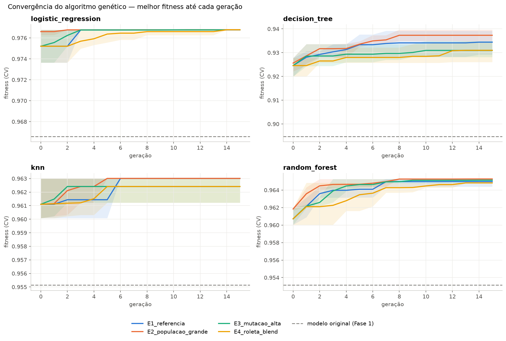
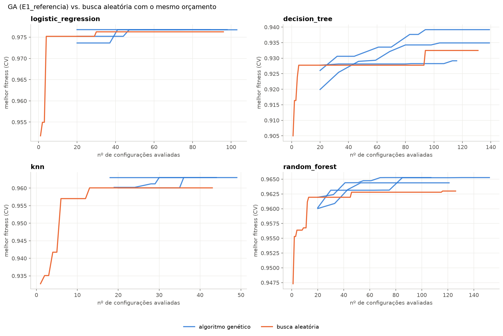
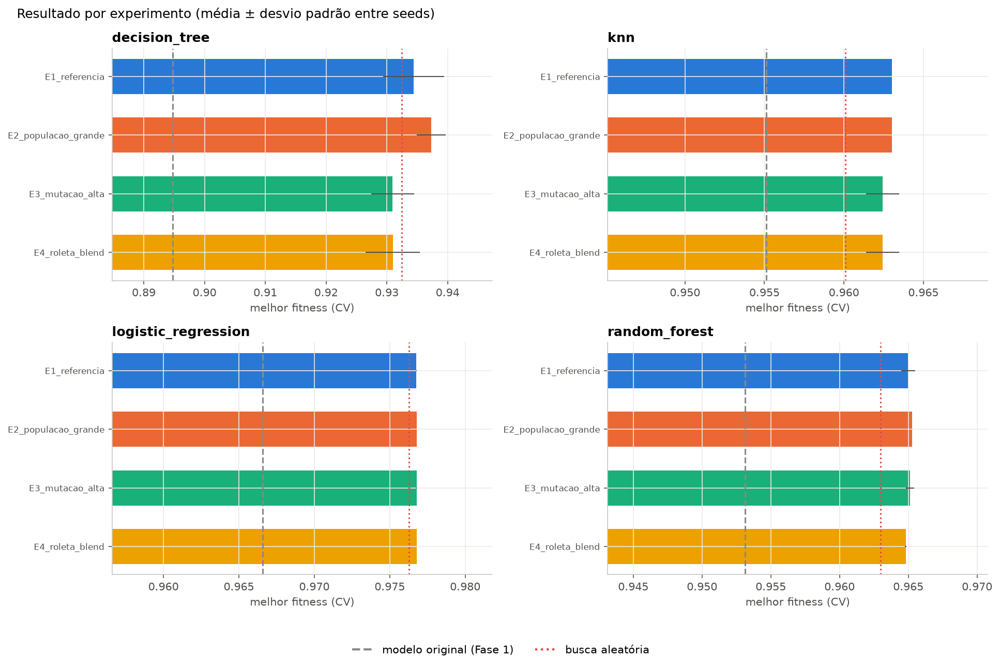
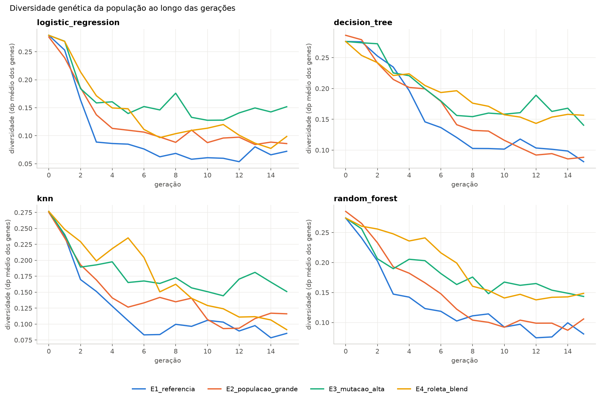
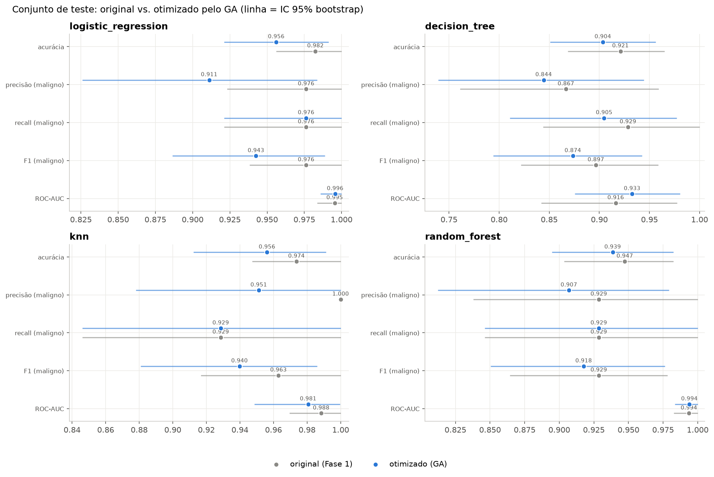
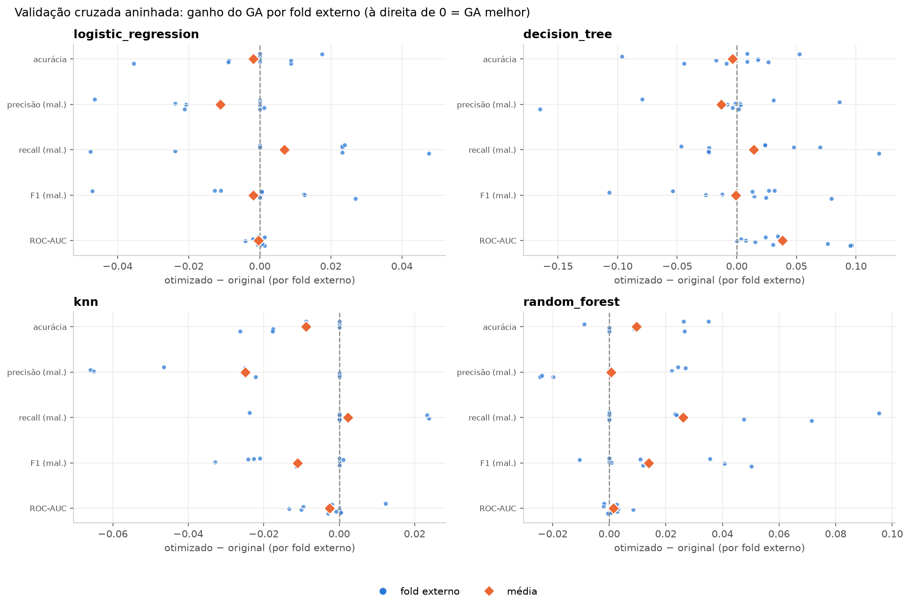
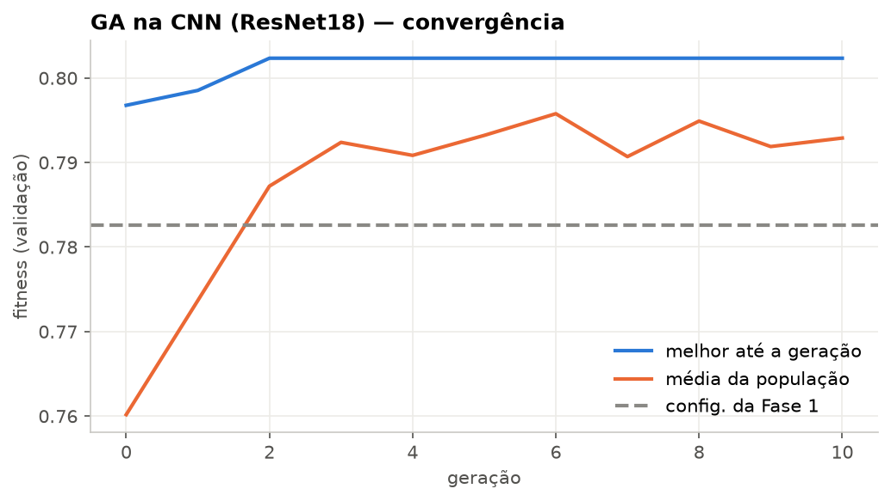
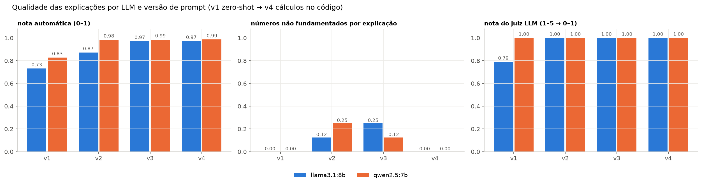
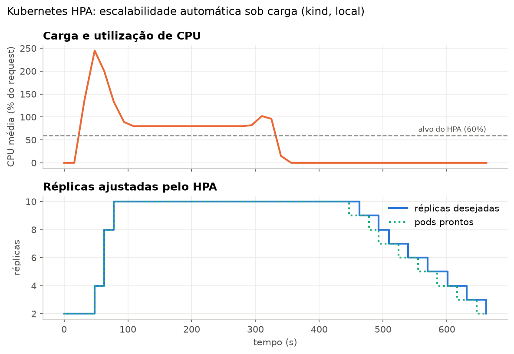

# Relatório Técnico — Tech Challenge Fase 2

**Projeto escolhido:** Projeto 1 — Otimização de modelos de diagnóstico com algoritmos genéticos + LLMs  
**Base:** modelos da Fase 1 (Breast Cancer Wisconsin — 4 modelos tabulares; CBIS-DDSM — CNN ResNet18)  
**Autor:** Wesley Sardi (entrega individual)

---

## 1. Objetivo e visão geral

Na Fase 1 treinei quatro classificadores tabulares (Logistic Regression, Decision Tree, KNN e
Random Forest) com hiperparâmetros escolhidos manualmente, e uma CNN de transfer learning em
mamografias. Nesta fase:

1. **Algoritmo genético (GA)** para otimizar os hiperparâmetros desses modelos, com codificação,
   operadores e fitness próprios, 4 configurações de experimento (3 seeds cada) e comparação com os
   modelos originais e com uma busca aleatória de mesmo orçamento.
2. **LLM local** (Llama 3.1 8B e Qwen 2.5 7B via Ollama, na GPU RTX 5070) para transformar a saída
   numérica do modelo em explicações para médicos, com 4 versões de prompt e avaliação de qualidade
   automática + LLM-como-juiz.
3. **Serviço escalável e observável**: API FastAPI, métricas Prometheus, logs JSON, dashboard
   Grafana, autoscaling com Kubernetes HPA (testado localmente com kind) e Cloud Run + Terraform
   (bônus de nuvem).

```
                     ┌──────────────────── OTIMIZAÇÃO (offline) ────────────────────┐
 Dataset Wisconsin → │ split = Fase 1 → GA (seleção · crossover · mutação)          │
 (569 pacientes)     │                    ↕ fitness = CV 5x3 no TREINO              │
                     │ → modelos otimizados (.joblib) → teste + CV aninhada         │
                     └──────────────────────────────┬───────────────────────────────┘
                                                    │ melhor em CV = modelo de produção
                     ┌──────────────────── SERVIÇO (online) ─────▼───────────────────┐
 Médico / sistema →  │ Nginx / Service K8s / Cloud Run → API FastAPI (réplicas 1..N) │
                     │   /predict → modelo   /explain,/ask → contexto SHAP → LLM     │
                     │   (Ollama, GPU local) → avaliação automática da explicação    │
                     │   /metrics → Prometheus → Grafana + alertas │ HPA escala pods │
                     └───────────────────────────────────────────────────────────────┘
```

O diagrama detalhado (Mermaid) está no [README](README.md#arquitetura).

---

## 2. Algoritmo genético

### 2.1 Codificação (representação dos genes)

Cada indivíduo é um vetor de números reais em [0, 1) — **um gene por hiperparâmetro**. A
decodificação depende do tipo do gene (`src/ga/genes.py`):

| Tipo de gene | Decodificação | Exemplo |
|---|---|---|
| `IntGene(low, high)` | divide [0,1) em `high−low+1` faixas iguais | `max_depth` ∈ {2..20} |
| `FloatGene(low, high, log)` | linear, ou exponencial quando `log=True` | `C` ∈ [10⁻³, 10³] em escala log |
| `CategoricalGene(choices)` | divide [0,1) em uma faixa por opção | `class_weight` ∈ {None, "balanced"} |

Por que essa representação: (1) os **mesmos operadores** de crossover e mutação servem para qualquer
modelo, independentemente de o hiperparâmetro ser inteiro, contínuo ou categórico; (2) a escala log
dá a mesma chance a C=0,01 e C=100 (com escala linear, 99,9% da faixa seria C>1); (3) uma mutação
pequena no gene vira um passo pequeno no hiperparâmetro (localidade), o que favorece o refinamento.

Espaços de busca (`src/ga/search_spaces.py`):

| Modelo | Genes |
|---|---|
| Logistic Regression | `C` (log 10⁻³–10³), `l1_ratio` (0 = L2 … 1 = L1, elastic-net), `class_weight` |
| Decision Tree | `max_depth` (2–20), `min_samples_split` (2–30), `min_samples_leaf` (1–15), `criterion`, `max_features`, `class_weight` |
| KNN | `n_neighbors` (1–40), `weights` (uniforme/distância), `p` (Manhattan/Euclidiana) |
| Random Forest | `n_estimators` (50–400), `max_depth` (2–20), `min_samples_leaf` (1–10), `max_features`, `criterion`, `class_weight` |

`class_weight` aparece em todos os modelos que o suportam porque o dataset é desbalanceado (~37% de
malignos) e o objetivo clínico prioriza o recall de malignos.

### 2.2 Operadores

`src/ga/operators.py` + laço geracional em `src/ga/engine.py`:

- **Seleção por torneio** (k=3): sorteia 3 indivíduos e escolhe o melhor. É a seleção padrão, porque
  a pressão seletiva é controlável por k e não depende da escala do fitness.
- **Seleção por roleta** (alternativa, no E4): probabilidade proporcional ao fitness *deslocado pelo
  pior da população*. Sem o deslocamento, fitness entre 0,93 e 0,98 dariam probabilidades quase
  iguais, e a roleta viraria sorteio uniforme.
- **Crossover uniforme** (taxa 0,8): cada gene vem de um dos pais com probabilidade ½. Os
  hiperparâmetros são praticamente independentes, então não há "blocos" a preservar (o que
  justificaria crossover de 1 ponto).
- **Crossover BLX-α** (alternativa, no E4): o gene do filho é sorteado num intervalo que envolve os
  dos pais (α=0,5). Explora valores *entre* e *ao redor* dos pais, o que é útil para genes contínuos.
- **Mutação gaussiana** (taxa por gene 0,10, σ=0,15) + **mutação por reinício** (taxa 0,02, sorteia o
  gene de novo): a primeira refina e a segunda dá saltos grandes contra a convergência prematura.
- **Elitismo** (2 indivíduos): os melhores passam intactos, então o melhor fitness nunca piora.
- **População inicial semeada**: a configuração original da Fase 1 entra como um dos indivíduos e
  o restante é aleatório. Assim o GA parte, no mínimo, da solução atual.
- **Cache por hiperparâmetros decodificados**: genomas diferentes que decodificam para o mesmo modelo
  não são reavaliados. A avaliação é a parte cara, então isso faz diferença.
- **Avaliação paralela**: os indivíduos novos de cada geração são avaliados em paralelo (joblib, 20
  núcleos). O resultado não muda, só o tempo (cerca de 6× mais rápido na Decision Tree).

### 2.3 Função fitness

`src/ga/fitness.py`:

```
fitness = 0,5 · F1(maligno) + 0,3 · Recall(maligno) + 0,2 · ROC-AUC
```

calculada com **validação cruzada estratificada repetida (5 folds × 3 repetições) somente no conjunto
de treino**. Justificativas:

- **F1 de malignos** equilibra precisão e recall e evita o modelo degenerado que chama tudo de
  maligno;
- **Recall de malignos** recebe peso extra porque o falso negativo (câncer não detectado) é o erro
  clinicamente mais grave;
- **ROC-AUC** mede a qualidade da probabilidade, que é justamente o que a LLM vai explicar ao médico;
- **CV repetida** e não simples: com 455 amostras de treino, um único particionamento em 5 folds é
  ruidoso, e o GA, por ser um otimizador agressivo, acaba "aprendendo" o ruído dos folds. No teste
  rápido com CV simples isso aconteceu no KNN: o fitness em CV subiu e o desempenho no teste caiu;
- **o teste nunca entra no fitness**: ele só é usado uma vez, no fim, para comparar original vs.
  otimizado. A escolha da melhor configuração também é feita pelo fitness em CV, nunca pelo teste.

### 2.4 Experimentos

Cada experimento varia **um** fator em relação ao E1, para que a diferença seja atribuível àquele
fator. Todos usam 15 gerações e 3 seeds (42, 7, 2024).

| Experimento | População | Mutação (taxa/σ) | Seleção | Crossover |
|---|---|---|---|---|
| E1_referencia | 20 | 0,10 / 0,15 | torneio k=3 | uniforme |
| E2_populacao_grande | **40** | 0,10 / 0,15 | torneio k=3 | uniforme |
| E3_mutacao_alta | 20 | **0,30 / 0,25** | torneio k=3 | uniforme |
| E4_roleta_blend | 20 | 0,10 / 0,15 | **roleta** | **BLX-α** |

Linha de base adicional: **busca aleatória** com o mesmo número de avaliações do E1. Ela responde à
pergunta "o GA ajuda, ou qualquer busca resolveria?".

## 3. Resultados da otimização

### 3.1 Fitness em validação cruzada (treino)

Média do melhor fitness entre as 3 seeds (desvio padrão entre parênteses) e linhas de base:

| Modelo | Original (Fase 1) | Busca aleatória | E1 | E2 (pop. 40) | E3 (mutação alta) | E4 (roleta + BLX) |
|---|---|---|---|---|---|---|
| Logistic Regression | 0,9666 | 0,9763 | 0,9768 (0) | 0,9768 (0) | 0,9768 (0) | 0,9768 (0) |
| Decision Tree | 0,8948 | 0,9325 | 0,9344 (0,005) | **0,9373** (0,002) | 0,9310 (0,004) | 0,9310 (0,005) |
| KNN | 0,9551 | 0,9601 | **0,9630** (0) | **0,9630** (0) | 0,9624 (0,001) | 0,9624 (0,001) |
| Random Forest | 0,9531 | 0,9630 | 0,9650 (0,001) | **0,9653** (0) | 0,9651 (0) | 0,9648 (0) |



**Leitura dos experimentos:**

- **O GA superou o modelo original em todos os modelos** (+1 a +4,5 pontos de fitness) e **superou a
  busca aleatória de mesmo orçamento em todos**. A vantagem é pequena na Logistic Regression, cujo
  espaço tem só 3 genes e é fácil, e maior na Decision Tree (6 genes, superfície irregular).
  
- **E2 (população 40)** deu o melhor resultado e a menor variância entre seeds, mas avaliou cerca de
  2× mais configurações (213 contra 99 no E1, em média). Por avaliação, o E1 é mais eficiente.
- **E3 (mutação 0,30)** manteve a diversidade alta por mais tempo (figura de diversidade), mas
  refinou menos. Na Decision Tree terminou abaixo do E1: mais exploração e menos aproveitamento.
- **E4 (roleta + BLX-α)** convergiu mais devagar (curva laranja). Mesmo com o deslocamento pelo
  pior indivíduo, a roleta aplica menos pressão seletiva que o torneio quando os fitness são
  próximos.
- A **semente com a configuração da Fase 1** garantiu que nenhuma execução ficasse abaixo do original.




**Hiperparâmetros encontrados** (melhor execução de cada modelo):

| Modelo | Fase 1 | Otimizado pelo GA |
|---|---|---|
| Logistic Regression | C=1, L2, sem class_weight | C=0,38, l1_ratio=0,18 (elastic-net), class_weight=balanced |
| Decision Tree | max_depth=5, demais padrão | max_depth=8, min_samples_split=9, min_samples_leaf=3, max_features=log2, balanced |
| KNN | k=7, uniforme, Euclidiana | k=4, uniforme, Manhattan |
| Random Forest | 300 árvores, max_depth=6 | 343 árvores, max_depth=6, max_features=log2, entropy, balanced |

O GA escolheu `class_weight="balanced"` em todos os modelos que o têm, o que é coerente com o peso
de recall no fitness: o limiar efetivo se desloca a favor da classe maligna.

### 3.2 Comparação no conjunto de teste (114 pacientes)

| Modelo | Versão | Acurácia | Precisão (mal.) | Recall (mal.) | F1 (mal.) | ROC-AUC |
|---|---|---|---|---|---|---|
| Logistic Regression | original | 0,982 | 0,976 | 0,976 | 0,976 | 0,995 |
| | otimizado | 0,956 | 0,911 | 0,976 | 0,943 | 0,996 |
| Decision Tree | original | 0,921 | 0,867 | 0,929 | 0,897 | 0,916 |
| | otimizado | 0,904 | 0,844 | 0,905 | 0,874 | 0,933 |
| KNN | original | 0,974 | 1,000 | 0,929 | 0,963 | 0,988 |
| | otimizado | 0,956 | 0,951 | 0,929 | 0,940 | 0,981 |
| Random Forest | original | 0,947 | 0,929 | 0,929 | 0,929 | 0,994 |
| | otimizado | 0,939 | 0,907 | 0,929 | 0,918 | 0,994 |



**No teste, o ganho em CV não apareceu.** O recall se manteve e a precisão caiu um pouco. Só que o
teste tem 114 pacientes (42 malignos): **1 paciente equivale a 0,9 ponto de acurácia e 2,4 pontos de
recall**, e os intervalos de confiança de 95% por bootstrap (linhas na figura) se sobrepõem quase
totalmente. Com uma única partição pequena não dá para afirmar nem que o GA melhorou, nem que piorou.
Isso me levou à análise seguinte.

### 3.3 Comparação robusta: validação cruzada aninhada

Para separar ganho real de ruído (e da **"maldição do vencedor"**: escolher a melhor entre centenas de
configurações infla o fitness em CV), fiz uma **validação cruzada aninhada** (`main_nested_cv.py`):
5 folds externos × 2 repetições sobre os 569 pacientes. Em cada fold externo o GA (config. E1) roda
só no treino externo, e original e otimizado são avaliados, **pareados**, no fold externo, que o GA
nunca viu. Cada paciente é avaliado 2 vezes fora da amostra.

| Modelo | Métrica | Original | Otimizado | Δ médio | Vitórias/empates/derrotas | Wilcoxon p |
|---|---|---|---|---|---|---|
| **Random Forest** | F1 (mal.) | 0,942 | **0,956** | **+1,4 pt** | 6 / 3 / 1 | **0,047** |
| | Recall (mal.) | 0,931 | **0,958** | **+2,6 pt** | 5 / 5 / 0 | 0,063 |
| | Acurácia | 0,958 | 0,968 | +1,0 pt | 5 / 4 / 1 | 0,094 |
| **Decision Tree** | ROC-AUC | 0,924 | **0,963** | **+3,8 pt** | 9 / 1 / 0 | **0,004** |
| | Recall (mal.) | 0,913 | 0,927 | +1,4 pt | 5 / 0 / 5 | 0,31 |
| | F1 (mal.) | 0,912 | 0,911 | −0,1 pt | 6 / 0 / 4 | 0,77 |
| Logistic Regression | F1 (mal.) | 0,965 | 0,963 | −0,2 pt | 5 / 2 / 3 | 0,95 |
| | Recall (mal.) | 0,950 | 0,957 | +0,7 pt | 5 / 3 / 2 | 0,63 |
| KNN | Precisão (mal.) | 0,983 | 0,958 | **−2,5 pt** | 0 / 4 / 6 | **0,031** |
| | F1 (mal.) | 0,955 | 0,944 | −1,1 pt | 1 / 4 / 5 | 0,063 |



**Conclusão sobre a otimização:**

- **Random Forest:** ganho real de F1 e de recall de malignos, ou seja, menos cânceres não
  detectados, sem perda de precisão.
- **Decision Tree:** ganho real e significativo em ROC-AUC. As probabilidades ficaram muito melhores
  (árvore mais profunda, com folhas mínimas, em vez de max_depth=5), embora o F1 no limiar de 0,5
  tenha ficado igual.
- **Logistic Regression:** neutra. O modelo original já estava praticamente no ótimo; regressão
  logística em dados padronizados é pouco sensível aos hiperparâmetros.
- **KNN:** o GA **piorou** a precisão. Com só 3 genes e fitness quase plano, o GA escolheu k=4, que
  se ajusta à CV interna, enquanto o k=7 original generalizava melhor. É um caso claro de
  overfitting da seleção de hiperparâmetros.

Ou seja, **o GA vale a pena quando o espaço de hiperparâmetros é rico e o modelo é sensível a ele**
(árvores e florestas). Para modelos simples com bons defaults, o ganho não compensa o risco de
superajustar a validação. Ressalva: são 10 partições pareadas e 20 comparações sem correção para
múltiplos testes, então os p-valores devem ser lidos como indicativos.

O **modelo de produção** é escolhido pela regra fixada antes de olhar o teste: o otimizado com maior
fitness em CV, que foi a **Logistic Regression** (0,977). Pela validação aninhada, ela tem
desempenho equivalente ao original (F1 ≈ 0,96, recall ≈ 0,96) e continua sendo o modelo de maior F1
absoluto entre os quatro.

### 3.4 Extra: GA na CNN (ResNet18, transfer learning)

Genes: learning rate (log 10⁻⁵–3·10⁻³), weight decay (log), dropout, ponto de descongelamento da
ResNet (layer2/layer3/layer4/só a cabeça), batch size e um multiplicador do peso da classe maligna.
Com 3.484 imagens pré-carregadas em memória, aumento de dados na GPU e precisão mista (bfloat16),
**cada época leva cerca de 2 s na RTX 5070**. Na Fase 1 o treino era em CPU. Configuração:
população 12, 10 gerações, 6 épocas por indivíduo, avaliação no conjunto de validação agrupado por
paciente. A configuração vencedora foi re-treinada por até 20 épocas (early stopping) e só então
avaliada no teste oficial.

Duas decisões vieram de problemas observados:

1. **Fitness próprio para a CNN** (0,4 F1 + 0,1 recall + 0,5 ROC-AUC). No teste rápido, os pesos
   dos modelos tabulares davam fitness de cerca de 0,69 ao classificador degenerado "tudo maligno",
   acima da configuração original. O AUC vale 0,5 para esse classificador, então recebe o maior peso.
2. **Média de 2 seeds por indivíduo.** Na 1ª execução (1 treino por indivíduo), o melhor indivíduo
   foi um "sortudo" da geração 0 que o elitismo nunca deixou sair, e o GA não melhorou em 10
   gerações. Com a média de 2 treinos o ruído cai e o resultado no teste melhorou (tabela abaixo).

| Teste (704 imagens) | Acurácia | Precisão (mal.) | Recall (mal.) | F1 (mal.) | ROC-AUC |
|---|---|---|---|---|---|
| Config. Fase 1 (re-treinada na GPU) | 0,659 [0,622–0,695] | 0,563 | 0,583 | 0,573 [0,523–0,622] | 0,719 [0,678–0,755] |
| GA, 1ª execução (1 seed/indivíduo) | 0,668 | 0,566 | 0,652 | 0,606 | 0,735 |
| **GA, 2ª execução (2 seeds/indivíduo)** | **0,697** [0,663–0,730] | **0,615** | **0,612** | **0,613** [0,562–0,661] | **0,744** [0,708–0,779] |



O GA encontrou uma configuração interpretável: **learning rate cerca de 5× maior** (4,9·10⁻⁴ contra
10⁻⁴) e **1,5× mais peso na classe maligna**, mantendo layer3 e batch 32. Ganho de 3,8 pontos de
acurácia, 4 de F1 e 2,5 de AUC (77 avaliações, 22 min). Os ICs ainda se sobrepõem parcialmente.
Também ficou visível o **gap validação → teste** (AUC 0,85 na validação contra 0,74 no teste), uma
diferença conhecida entre os conjuntos oficiais do CBIS-DDSM. Ela limita o quanto qualquer ajuste de
hiperparâmetros consegue melhorar. O teto da CNN é dado pelos dados (recortes de baixa resolução,
cerca de 2.400 imagens de treino), não pelos hiperparâmetros.

---

## 4. Integração com LLMs

### 4.1 Escolha do modelo

LLMs **locais via Ollama**, na GPU RTX 5070 (12 GB): **Llama 3.1 8B** (Meta, citado no enunciado) e
**Qwen 2.5 7B** (Alibaba, melhor em português). Ambos quantizados em 4 bits (~5 GB cada). Motivos:

- **privacidade**: dados de pacientes não saem da máquina, o que facilita a adequação à LGPD em
  ambiente hospitalar;
- custo zero por chamada e latência previsível;
- dois modelos permitem comparar a qualidade e usar um como **juiz do outro**.

O cliente (`src/llm/client.py`) tem interface única e aceita qualquer servidor compatível com a API
da OpenAI (`LLM_PROVIDER=openai`). Trocar de provedor não exige mudar o código.

### 4.2 Do número ao insight: o contexto do caso

A LLM **não recebe o dataset nem o modelo**. Recebe apenas um contexto estruturado, montado em
`src/llm/context.py`:

- classificação, probabilidade de malignidade e **nível de confiança** (pela distância ao limiar de 50%);
- os **5 fatores mais influentes** para *aquele* paciente, calculados com **SHAP** (permutation
  explainer, agnóstico ao modelo) sobre a probabilidade de malignidade. Cada contribuição sai em
  **pontos de probabilidade** ("+18 pontos"), uma unidade fácil de comunicar;
- para cada fator, o **percentil** do valor do paciente na base e as **medianas de benignos e de
  malignos**. É isso que transforma "worst concave points = 0,162" em "valor no percentil 82,
  próximo da mediana dos malignos (0,182) e bem acima da dos benignos (0,074)";
- desempenho do modelo no teste, para a LLM comunicar a confiabilidade;
- nomes das features traduzidos para o português clínico ("pontos côncavos — pior valor");
- um campo `clinical_notes` (texto livre) que já passa pela API e vai para o prompt. É o **gancho
  para o Módulo 3** (integração com dados textuais).

Restringir a LLM a esse contexto é a principal defesa contra alucinação: tudo que ela afirma deve
ser rastreável a um campo do contexto, e isso é verificado automaticamente (4.4).

### 4.3 Prompt engineering

Quatro versões (`src/llm/prompts.py`). Cada uma acrescenta técnicas à anterior, o que permite medir o
efeito de cada uma (o texto integral de todos os prompts está no
[Anexo A](#anexo-a--prompts-utilizados)):

| Versão | Técnicas |
|---|---|
| **v1_zero_shot** | Pedido direto + JSON do contexto. Sem papel, sem regras, saída livre (linha de base). |
| **v2_estruturado** | **Persona** (assistente de apoio à decisão clínica) e público-alvo (mastologistas/patologistas); **9 regras explícitas** (usar só o contexto, reproduzir classificação/probabilidade, respeitar a direção de cada fator, converter contribuição em pontos percentuais, nunca diagnóstico definitivo, sinalizar casos limítrofes, condutas só de investigação); **contexto delimitado** em `<contexto>`; **saída estruturada** restrita a um **JSON Schema** (structured outputs do Ollama). |
| **v3_few_shot** | v2 + **exemplo completo** (few-shot: contexto fictício → resposta ideal) + **checklist de auto-verificação** antes de responder. |
| **v4_calculos_no_codigo** | v3 + **contexto enriquecido com os valores derivados já calculados no código** (probabilidade em %, distância ao limiar, contribuição em pontos percentuais, ranking de impacto) + regra "copie, não recalcule". Criada a partir dos erros observados na avaliação da v3 (ver 4.4). |

A saída estruturada (resumo, classificação, probabilidade, confiança, fatores com efeito e
interpretação, insights acionáveis, limitações, aviso) tem duas vantagens: (1) é renderizada de forma
consistente para o médico; (2) permite **validar campo a campo** (a classificação bate? a direção de
cada fator bate?).

Para **perguntas livres** (`/ask`), um prompt próprio limita a resposta a 5 frases, manda recusar o
que está fora do escopo (tratamento, prognóstico) e indicar que informação faltaria.

### 4.4 Avaliação da qualidade das interpretações

Protocolo (`main_llm.py`): **8 pacientes do teste** escolhidos para cobrir casos difíceis (2 erros
do modelo, 2 limítrofes, 2 malignos e 2 benignos típicos) × **2 LLMs** × **4 versões de prompt** = 64
explicações. Duas camadas de avaliação:

**(a) Métricas automáticas objetivas** (`src/llm/quality.py`), comparando o texto com o contexto:

| Métrica | O que verifica |
|---|---|
| consistência | classificação, probabilidade e nível de confiança iguais aos do modelo |
| **grounding** | todo número citado existe no contexto (ou é derivação direta: %, pontos, distância ao limiar). O que sobra é alucinação |
| cobertura | os 5 fatores principais são mencionados |
| direção | o efeito (↑/↓ risco) de cada fator bate com o sinal do SHAP |
| aviso de segurança | deixa claro que não é diagnóstico definitivo |
| coerência de incerteza | sinaliza caso limítrofe quando a confiança não é alta, e **não** o faz quando é alta |
| linguagem | ausência de nomes de campos técnicos (`prob_malignant`...) e índice Flesch-PT de legibilidade |

**(b) LLM-como-juiz cruzado:** cada LLM é avaliada pela outra (evita autopreferência), com notas de
1 a 5 em fidelidade, clareza, utilidade clínica e segurança.

**Resultados:**

| LLM | Prompt | Nota auto. | Números não fundamentados | Aviso | Incerteza coerente | Campos crus | Flesch-PT | Latência | Juiz |
|---|---|---|---|---|---|---|---|---|---|
| Llama 3.1 8B | v1 zero-shot | 0,73 | 0 | 0% | 63% | 9,1/texto | 69 | 15,5 s | 4,2 |
| | v2 estruturado | 0,87 | 1 em 8 | 50% | 50% | 0 | 60 | 12,6 s | 5,0 |
| | v3 few-shot | 0,97 | 2 em 8 | 100% | 88% | 0 | 49 | 13,6 s | 5,0 |
| | **v4 cálculos no código** | **0,97** | **0** | 100% | 88% | 0 | 50 | 13,2 s | 5,0 |
| Qwen 2.5 7B | v1 zero-shot | 0,83 | 0 | 50% | 75% | 7,5/texto | 55 | 13,9 s | 5,0 |
| | v2 estruturado | 0,98 | 2 em 8 | 100% | 100% | 0 | 45 | 13,0 s | 5,0 |
| | v3 few-shot | 0,99 | 1 em 8 | 100% | 100% | 0 | 45 | 12,5 s | 5,0 |
| | **v4 cálculos no código** | **0,99** | **0** | 100% | 100% | 0 | 48 | 12,4 s | 5,0 |

Classificação, probabilidade e direção dos fatores ficaram **100% corretas** em todas as versões
estruturadas, e o JSON foi válido em 100% dos casos (structured outputs).



**O que a avaliação mostrou:**

1. **Cada técnica de prompt teve efeito mensurável.** O **v1** não interpreta: devolve o JSON campo a
   campo (9 nomes técnicos por texto, 2× mais longo, sem aviso). Tem zero números inventados só
   porque **copia** os números, sem transformá-los em insight. O **v2** (persona + regras + JSON
   Schema) elimina o jargão e introduz a estrutura. O **v3** (few-shot) leva o aviso a 100% e
   ensina a comparar o paciente com as medianas.
2. **Os erros residuais eram de aritmética e de ordenação, não de leitura.** Inspecionando os 7
   números marcados como não fundamentados, todos eram erros reais: "a 22,3 pontos do limiar" com
   p=0,677 (o certo é 17,7), "415% de lesões malignas" (taxa-base 0,415), valor da feature informado
   como contribuição. No Q&A, a pergunta "o que mais pesou?" foi respondida com o maior fator
   *positivo* em vez do de maior impacto absoluto, e com o sinal invertido.
3. **Correção: a v4 faz as contas no código.** O contexto passou a trazer já calculados a
   probabilidade em %, a distância ao limiar, a contribuição em pontos percentuais e o ranking de
   impacto. Resultado: **zero números não fundamentados nos dois LLMs**, e o Q&A passou a acertar
   ("simetria do núcleo — pior valor, −5,7 pontos percentuais"). Lição de engenharia: **LLMs
   pequenas explicam bem, mas não devem calcular.**
4. **O few-shot também tem efeito colateral.** O Llama copiou do exemplo a frase "Por ser caso
   limítrofe, considerar biópsia" num caso com probabilidade 0,0, e no v2 aplicou a regra "diga que
   é limítrofe" a casos de confiança alta. O Qwen não teve esse problema (100% de coerência).
5. **O LLM-como-juiz saturou.** Juízes de 7–8B deram nota 5 em 92% das avaliações, inclusive a respostas
   v1 sem nenhum aviso de segurança. Não discriminaram as versões, ao contrário das métricas
   objetivas. Um juiz útil exigiria um modelo maior ou avaliação por especialistas.
6. **Eu também errei a métrica primeiro.** A regex de "aviso" deixava passar formas válidas ("não
   deve ser considerado diagnóstico definitivo") e a de incerteza contava "o caso **não** é
   limítrofe" como contradição. Corrigi após inspeção manual, reavaliei sem gerar de novo
   (`main_llm.py --rescore`) e cobri os casos com testes. Métricas automáticas precisam ser validadas
   contra leitura humana.
7. **Limitação fundamental:** a LLM explica o modelo, ela não o corrige. No paciente T541 (benigno),
   o modelo errou com probabilidade de 68%, e a explicação foi coerente e convincente, porque é fiel
   ao modelo. A camada de LLM aumenta a interpretabilidade, mas também pode aumentar a **confiança em
   um erro**. Por isso o aviso, a sinalização de incerteza e a decisão final do médico são inegociáveis.

**Escolha para produção:** **Qwen 2.5 7B + prompt v4** (melhor nota, 100% de coerência de incerteza,
zero números não fundamentados, ~12 s por explicação na RTX 5070).

Exemplo real (Qwen 2.5 7B, v4, caso limítrofe T495, probabilidade de malignidade 21,6%):

> **Pergunta:** Qual característica mais pesou para essa classificação e por quê?
> **Resposta:** A característica que mais pesou para essa classificação foi a "simetria do núcleo —
> pior valor", com uma contribuição de -5,7 pontos percentuais. Isso significa que um valor mais alto
> nesta medida reduziu a probabilidade de malignidade, empurrando a classificação para o lado benigno.
>
> **Pergunta:** Qual o tratamento indicado para essa paciente?
> **Resposta:** Os dados fornecidos não são suficientes para indicar um tratamento específico. [...]
> Recomenda-se realizar uma biópsia de core para confirmação e considerar a avaliação por um
> mastologista para orientações sobre o manejo clínico.

Todas as 64 explicações, com contexto, métricas e notas do juiz, estão em
`outputs/reports/llm_explanations.jsonl`.

---

## 5. Base para o Módulo 3

- `CaseContext.clinical_notes` e o campo `clinical_notes` da API já levam **texto clínico livre**
  até o prompt. O Módulo 3 só precisa preencher esse campo (laudos, anamnese).
- O cliente de LLM é desacoplado (Ollama/OpenAI-compatível), e o endpoint `/ask` já implementa a
  conversa sobre um caso, que é a base de um assistente médico.
- A avaliação automática (grounding, segurança) roda a cada explicação servida e vira métrica
  Prometheus. Isso é monitoramento contínuo de qualidade, pronto para quando o assistente crescer.

---

## 6. Escalabilidade, monitoramento e logging

### 6.1 API

`src/api/app.py` (FastAPI, documentação OpenAPI em `/docs`):

| Endpoint | Função |
|---|---|
| `POST /predict` | classificação em lote (1–500 pacientes), sem LLM: rápido e barato |
| `POST /explain` | predição + fatores SHAP + explicação da LLM + nota automática de qualidade |
| `POST /ask` | pergunta em linguagem natural sobre o caso |
| `GET /model`, `/examples`, `/health`, `/metrics` | metadados, exemplos, saúde e métricas |

O **modelo de produção** é escolhido automaticamente: o otimizado com maior fitness em CV (o teste não
entra na escolha). Separar `/predict` (CPU, milissegundos) de `/explain` (GPU, segundos) é uma decisão
de arquitetura: cada caminho escala de forma independente, e a API continua útil mesmo com a LLM
indisponível (`/explain` com `use_llm=false` devolve os fatores SHAP; com a LLM desligada,
`/explain` responde 503 em vez de travar).

### 6.2 Monitoramento e logging

- **Logs estruturados em JSON** (`src/monitoring/logging_config.py`): cada requisição, cada geração do
  GA e cada chamada à LLM vira uma linha JSON com campos (latência, tokens, fitness...). Em container
  saem no stdout, que é o formato que Cloud Logging/Loki indexam. O histórico completo dos
  experimentos fica em `outputs/logs/ga.jsonl` e serve para tracking dos experimentos.
- **Métricas Prometheus** (`src/api/metrics.py`):
  - técnicas: requisições por endpoint/status, histograma de latência, requisições em andamento;
  - de modelo: predições por classe, **histograma da probabilidade de malignidade** e contagem de
    casos limítrofes. Se essa distribuição muda ao longo do tempo, é sinal de **drift** nos dados de
    entrada e de que o modelo precisa ser re-otimizado (o GA vira parte do ciclo de MLOps);
  - de LLM: latência, erros e **nota automática de qualidade de cada explicação servida**
    (monitoramento contínuo da qualidade, não só na avaliação offline).
- **Alertas** (`deploy/prometheus/alerts.yml`): latência p95 alta, taxa de erro 5xx > 5%, falhas da
  LLM, possível drift (proporção de malignos a mais de 20 pontos da base) e excesso de casos limítrofes.
- **Dashboard Grafana** provisionado automaticamente (`deploy/grafana/`): réplicas ativas, req/s,
  erros, latência p50/p95 por endpoint, predições por classe, heatmap da probabilidade (drift),
  latência e nota da LLM.

### 6.3 Escalabilidade automática

A API é **stateless** (modelo carregado em memória, sem sessão), então escala horizontalmente:

| Ambiente | Mecanismo |
|---|---|
| Docker Compose (`docker-compose.yml`) | 3 réplicas atrás de Nginx. O Nginx re-resolve o DNS a cada 10 s, então `docker compose up --scale api=N` entra no balanceamento sem reinício. Prometheus descobre cada réplica via DNS. |
| **Kubernetes** (`deploy/k8s/`) | Deployment com requests/limits, readiness/liveness probes e **HorizontalPodAutoscaler** (2–10 réplicas, alvo de 60% de CPU, sobe rápido e desce devagar com janela de estabilização de 120 s para evitar oscilação). |
| **Cloud Run** (`infra/terraform/`) | autoscaling gerenciado por concorrência (40 req/instância), de **0** a 5 instâncias. |

**Resultados medidos:**

*Docker Compose:* 3 réplicas atrás do Nginx distribuíram a carga de forma equilibrada
(771 / 849 / 795 requisições), com 160 req/s e p95 de 55 ms (lotes de 10 pacientes). Com
`--scale api=5` as novas réplicas entraram no balanceamento e no Prometheus sem reinício: 313 req/s.
Problema encontrado: a descoberta por DNS do Prometheus (`dns_sd_configs`) só via 1 das 3 réplicas,
então troquei por `docker_sd_configs`, que lista os containers pela API do Docker.

*Kubernetes HPA* (`scripts/k8s_demo.sh`, cluster local **kind**, carga gerada **dentro** do cluster para
passar pelo balanceamento do Service):



| Fase | Concorrência | Réplicas | Req/s | p50 | p95 | Erros |
|---|---|---|---|---|---|---|
| início | 4 | 2 | 228 | 16 ms | 29 ms | 0 |
| pico (4 min) | 32 | 2 → **10** | 502 | 61 ms | 109 ms | 0 |
| após o pico | 4 | 10 | 700 | 5 ms | 9 ms | 0 |

Com a carga, o HPA levou as réplicas de **2 → 4 → 8 → 10 em cerca de 45 s**. Depois do pico, esperou
a janela de estabilização (120 s) e **reduziu 1 pod a cada ~30 s** até voltar a 2, exatamente como
configurado (sobe rápido, desce devagar). Não houve nenhum erro durante as transições. Observação:
no teto de 10 réplicas a CPU ficou em ~80% (acima do alvo de 60%) porque o cluster local dividia a
CPU com a validação aninhada que rodava ao mesmo tempo. Num cluster real, o `maxReplicas` ou o
autoscaler de nós absorveriam isso.

---

## 7. Implementação em nuvem (bônus): Google Cloud Run + Terraform

Toda a infraestrutura está como código em `infra/terraform/`:

- **Artifact Registry** para a imagem, com política de limpeza (mantém as 3 mais recentes, pois o
  armazenamento acima de 0,5 GB é cobrado);
- **Cloud Run v2**: 1 vCPU / 1 GiB, `min_instances=0` (escala a zero: custo nulo sem tráfego),
  `max_instances=5` (teto de custo), concorrência 40, CPU cobrada só durante requisições, startup e
  liveness probes em `/health`, logs JSON indexados pelo Cloud Logging, conta de serviço dedicada;
- **Orçamento** com alertas em 50%, 90% e 100%;
- **Alerta de latência** p95 > 1 s (Cloud Monitoring).

O deploy é feito por `scripts/deploy_gcp.sh` (cria o registry, faz build/push da imagem e aplica o
restante) e a remoção por `terraform destroy`.

**Decisão:** a LLM **não vai para a nuvem**. GPU gerenciada custa caro e não se justifica para um
projeto acadêmico. Na nuvem a API serve predição + fatores SHAP (`LLM_ENABLED=0`). A explicação
roda localmente ou pode apontar para uma API externa (`LLM_PROVIDER=openai`) sem mudar código.

**Custo:** com o volume de uma demonstração, o uso fica dentro da cota gratuita mensal do Cloud Run
(requisições, vCPU-segundo e GiB-segundo), e contas novas ainda recebem créditos promocionais. O
orçamento com alertas protege contra esquecimentos. As cotas e preços devem ser conferidos em
https://cloud.google.com/run/pricing no momento do deploy, porque mudam com o tempo.

*Status:* a IaC está completa e validada estruturalmente, mas **não foi aplicada** porque depende
de uma conta GCP com faturamento ativo, que o autor ainda vai criar. A mesma imagem Docker já foi
testada localmente (container com `LLM_ENABLED=0`, o modo usado na nuvem: `/predict` e `/explain`
sem LLM funcionando, `/explain` com LLM respondendo 503) e escalada no Kubernetes. O passo a passo
está no README, seção 6.

---

## 8. Testes automatizados

`pytest` (`tests/`): **70 testes** cobrindo:

- **genes**: limites, cobertura uniforme dos inteiros, escala log, ida e volta da codificação, e
  configurações da Fase 1 representáveis em todos os espaços;
- **operadores**: torneio, roleta, os 3 crossovers (forma, limites, origem dos genes), mutação;
- **motor do GA**: convergência num problema com ótimo conhecido, monotonicidade do melhor fitness,
  elitismo, reprodutibilidade por seed, população semeada, cache, early stopping, busca aleatória;
- **fitness**: combinação ponderada correta, uso exclusivo do treino, determinismo, baseline idêntico
  à Fase 1 e IC de bootstrap;
- **LLM**: tradução das features, faixas de confiança, contexto consistente com o modelo (sinal SHAP
  ↔ efeito, ordenação), rótulo verdadeiro escondido do prompt, estrutura das 4 versões de prompt,
  parse de JSON, falha da LLM tratada e **métricas de qualidade** (resposta perfeita pontua alto;
  alucinação, rótulo invertido, direção trocada, termos de certeza e campos crus são detectados);
- **API**: todos os endpoints, validação de entrada (422) e exposição das métricas Prometheus.

Os testes não dependem do Ollama nem de artefatos gerados: usam um cliente de LLM falso
(`FakeLLMClient`) e modelos treinados no próprio teste.

---

## 9. Desafios enfrentados e soluções

| Desafio | Solução |
|---|---|
| GA "aprende" o ruído dos folds (KNN: melhor em CV, pior no teste) | CV **repetida** 5×3 no fitness + validação cruzada **aninhada** para a comparação final |
| Teste pequeno (114) torna diferenças de 1–2 pacientes indistinguíveis de ruído | **IC 95% por bootstrap** em todas as métricas de teste + teste pareado de Wilcoxon na CV aninhada |
| Avaliação cara (Random Forest ~1,5 s × 15 fits) | **cache** por hiperparâmetros decodificados + **avaliação paralela** da população (20 núcleos) |
| Roleta quase uniforme com fitness entre 0,93 e 0,98 | fitness **deslocado pelo pior indivíduo** antes de normalizar |
| PyTorch da Fase 1 era só CPU; RTX 5070 (Blackwell, sm_120) exige CUDA ≥ 12.8 | build **cu130** do PyTorch 2.14 (único com suporte a Python 3.14); treino ~2 s/época |
| CNN: fitness premiava o classificador "tudo maligno" | pesos próprios com **ROC-AUC dominante** (0,5 para classificador degenerado) |
| CNN: indivíduo "sortudo" preso pelo elitismo | fitness = **média de 2 seeds** por indivíduo |
| LLM errando contas e ordenação | **v4: valores derivados calculados no código** → zero números não fundamentados |
| LLM-como-juiz saturado (nota 5 em 92% das avaliações) | métricas objetivas como avaliação principal; juiz reportado com essa limitação |
| Métrica de aviso com falsos negativos | inspeção manual, regex ampliada, **reavaliação sem regenerar** (`--rescore`) + testes |
| Prometheus enxergando só 1 réplica via DNS | `docker_sd_configs` (descoberta pela API do Docker) |
| `kubectl port-forward` manda tudo para 1 pod (não testa o balanceamento) | gerador de carga como **pod dentro do cluster** |
| GPU na nuvem é cara para um projeto acadêmico | LLM local; na nuvem só predição + SHAP (`LLM_ENABLED=0`), provedor de LLM plugável |

## 10. Conclusão

- O **algoritmo genético** foi implementado do zero (codificação real normalizada, torneio/roleta,
  crossover uniforme/BLX-α, mutação gaussiana + reinício, elitismo, população semeada, cache e
  paralelismo) e testado em 4 configurações × 3 seeds. Em validação cruzada ele superou os modelos
  originais e a busca aleatória em todos os casos. A comparação rigorosa (CV aninhada) mostra que o
  ganho **generaliza para a Random Forest (F1 +1,4, recall +2,6 pontos) e para a Decision Tree
  (ROC-AUC +3,8 pontos)**, é neutro na Logistic Regression e negativo no KNN. Na CNN o GA melhorou
  acurácia (+3,8), F1 (+4,0) e AUC (+2,5 pontos). Um resultado honesto e acionável: vale otimizar
  modelos com espaço de hiperparâmetros rico, e o ganho precisa ser validado fora da amostra.
- A **integração com LLM** transforma probabilidade + SHAP em explicações clínicas fiéis ao modelo.
  A melhor configuração (Qwen 2.5 7B + v4) acertou classificação, probabilidade e direção dos fatores
  em 100% dos casos, incluiu aviso de segurança e sinalização de incerteza em 100% e não inventou
  nenhum número. Isso foi conseguido com prompt engineering iterativo e guiado por métricas, que
  mostrou que **LLMs pequenas devem explicar, não calcular**.
- A solução é **observável e escalável**: API stateless com métricas de modelo (drift), de LLM
  (qualidade) e de infraestrutura, dashboard e alertas, autoscaling demonstrado com HPA (2 → 10 → 2
  réplicas sem erros) e IaC para Cloud Run com teto de custo.

**Limitações:** dataset tabular pequeno (569 pacientes) e de uma única origem; métricas de LLM
automáticas e por juízes de 7–8B, sem avaliação por especialistas; a LLM pode tornar convincente um
erro do modelo. O sistema é **apoio à decisão** e não substitui a avaliação médica nem o exame
histopatológico.

**Próximos passos:** avaliação das explicações por médicos (escala Likert), juiz maior ou rubricas
com referência, calibração das probabilidades (que a LLM comunica) antes de explicar, GA
multiobjetivo (NSGA-II: recall × precisão × custo de inferência) e integração de dados textuais no
Módulo 3.

## Anexo A — Prompts utilizados

Texto integral dos prompts, extraído de `src/llm/prompts.py` (a mesma fonte usada nos experimentos e
na API). Os exemplos de mensagem usam o contexto real do paciente **T495** (caso limítrofe,
probabilidade de malignidade 21,6%).

### A.1 v1_zero_shot — linha de base

Uma única mensagem de usuário, sem mensagem de sistema e sem formato de saída:

```text
Explique este resultado de um modelo de diagnóstico de câncer de mama:
{"patient_id": "T495", "model_name": "logistic_regression", "predicted_label": "benigno", "prob_malignant": 0.216, "confidence": "moderada", "base_rate_malignant": 0.415, "top_factors": [{"feature": "worst symmetry", "feature_pt": "simetria do núcleo — pior valor", "value": 0.2369, "contribution": -0.057, "effect": "reduz_risco", "percentile": 16, "median_benign": 0.2678, "median_malignant": 0.3149, "closer_to": "benignos"}, {"feature": "radius error", "feature_pt": "raio do núcleo celular — erro padrão", "value": 0.2323, "contribution": -0.044, "effect": "reduz_risco", "percentile": 25, "median_benign": 0.2571, "median_malignant": 0.5222, "closer_to": "benignos"}, {"feature": "worst concavity", "feature_pt": "concavidade (profundidade das reentrâncias do contorno) — pior valor", "value": 0.17, "contribution": -0.035, "effect": "reduz_risco", "percentile": 38, "median_benign": 0.139, "median_malignant": 0.4209, "closer_to": "benignos"}, {"feature": "worst smoothness", "feature_pt": "suavidade do contorno (variação local do raio) — pior valor", "value": 0.1216, "contribution": -0.033, "effect": "reduz_risco", "percentile": 31, "median_benign": 0.1256, "median_malignant": 0.1437, "closer_to": "benignos"}, {"feature": "compactness error", "feature_pt": "compacidade (perímetro² / área − 1) — erro padrão", "value": 0.01371, "contribution": 0.026, "effect": "aumenta_risco", "percentile": 27, "median_benign": 0.01563, "median_malignant": 0.02882, "closer_to": "benignos"}], "model_performance": {"test_accuracy": 0.956, "test_precision_malignant": 0.911, "test_recall_malignant": 0.976, "test_f1_malignant": 0.943, "test_roc_auc": 0.996}}
```

### A.2 Mensagem de sistema (v2, v3 e v4)

Define a persona, o público-alvo e as 9 regras de fidelidade e segurança:

```text
Você é um assistente de apoio à decisão clínica de um hospital universitário, especializado em comunicar resultados de modelos de machine learning para médicos (mastologistas, patologistas e oncologistas).

O modelo analisa 30 medidas morfológicas de núcleos celulares extraídas de imagens digitalizadas de punção aspirativa por agulha fina (PAAF) de massa mamária e estima a probabilidade de a lesão ser maligna.

REGRAS OBRIGATÓRIAS
1. Use SOMENTE os dados do bloco <contexto>. Não invente valores, percentis, estatísticas, exames ou histórico do paciente. Todo número que você citar deve estar no contexto.
2. A classificação e a probabilidade são do MODELO. Reproduza-as exatamente; não reclassifique o caso.
3. Para cada fator, respeite o campo "effect": "aumenta_risco" significa que o valor empurrou a probabilidade para maligno; "reduz_risco", para benigno.
4. "contribution" está em pontos de probabilidade (0.12 = +12 pontos percentuais).
5. Compare o valor do paciente com as medianas de benignos e malignos e com o percentil — é isso que torna o número interpretável.
6. Nunca apresente o resultado como diagnóstico definitivo. Evite "certamente", "com certeza", "sem dúvida". O diagnóstico é do médico, com histopatologia.
7. Se a confiança for "baixa" ou "moderada", diga explicitamente que o caso é limítrofe e merece atenção redobrada.
8. Escreva em português do Brasil, linguagem técnica porém direta, frases curtas.
9. Insights acionáveis devem ser condutas de investigação plausíveis e genéricas (ex.: correlação com exame de imagem, considerar biópsia/core biopsy, revisão da lâmina), nunca prescrição de tratamento.
```

Na **v4**, o seguinte trecho é acrescentado ao final da mensagem de sistema:

```text
REGRAS PARA VALORES DERIVADOS
- Os campos prob_malignant_pct, distance_to_threshold_pp, base_rate_malignant_pct, contribution_pp e impact_rank já estão calculados: copie-os, NÃO recalcule.
- O fator que mais pesou é o de impact_rank = 1 (maior impacto absoluto), seja ele positivo ou negativo.
```

### A.3 Mensagem de usuário (v2, v3 e v4)

Contexto delimitado por `<contexto>` seguido da tarefa. Na v3 e na v4 a tarefa termina com o
checklist de auto-verificação. Mensagem real da **v4** para o paciente T495 (contexto enriquecido com
os campos derivados `*_pct`, `*_pp` e `impact_rank`):

```text
<contexto>
{
  "patient_id": "T495",
  "model_name": "logistic_regression",
  "predicted_label": "benigno",
  "prob_malignant": 0.216,
  "confidence": "moderada",
  "base_rate_malignant": 0.415,
  "top_factors": [
    {
      "feature": "worst symmetry",
      "feature_pt": "simetria do núcleo — pior valor",
      "value": 0.2369,
      "contribution": -0.057,
      "effect": "reduz_risco",
      "percentile": 16,
      "median_benign": 0.2678,
      "median_malignant": 0.3149,
      "closer_to": "benignos",
      "impact_rank": 1,
      "contribution_pp": -5.7
    },
    {
      "feature": "radius error",
      "feature_pt": "raio do núcleo celular — erro padrão",
      "value": 0.2323,
      "contribution": -0.044,
      "effect": "reduz_risco",
      "percentile": 25,
      "median_benign": 0.2571,
      "median_malignant": 0.5222,
      "closer_to": "benignos",
      "impact_rank": 2,
      "contribution_pp": -4.4
    },
    {
      "feature": "worst concavity",
      "feature_pt": "concavidade (profundidade das reentrâncias do contorno) — pior valor",
      "value": 0.17,
      "contribution": -0.035,
      "effect": "reduz_risco",
      "percentile": 38,
      "median_benign": 0.139,
      "median_malignant": 0.4209,
      "closer_to": "benignos",
      "impact_rank": 3,
      "contribution_pp": -3.5
    },
    {
      "feature": "worst smoothness",
      "feature_pt": "suavidade do contorno (variação local do raio) — pior valor",
      "value": 0.1216,
      "contribution": -0.033,
      "effect": "reduz_risco",
      "percentile": 31,
      "median_benign": 0.1256,
      "median_malignant": 0.1437,
      "closer_to": "benignos",
      "impact_rank": 4,
      "contribution_pp": -3.3
    },
    {
      "feature": "compactness error",
      "feature_pt": "compacidade (perímetro² / área − 1) — erro padrão",
      "value": 0.01371,
      "contribution": 0.026,
      "effect": "aumenta_risco",
      "percentile": 27,
      "median_benign": 0.01563,
      "median_malignant": 0.02882,
      "closer_to": "benignos",
      "impact_rank": 5,
      "contribution_pp": 2.6
    }
  ],
  "model_performance": {
    "test_accuracy": 0.956,
    "test_precision_malignant": 0.911,
    "test_recall_malignant": 0.976,
    "test_f1_malignant": 0.943,
    "test_roc_auc": 0.996
  },
  "prob_malignant_pct": 21.6,
  "distance_to_threshold_pp": 28.4,
  "base_rate_malignant_pct": 41.5
}
</contexto>

Explique o resultado do modelo para o médico responsável, preenchendo o JSON de resposta. Liste em 'fatores_principais' os fatores do contexto, na mesma ordem.

Antes de responder, verifique mentalmente (não escreva a verificação):
- a classificação e a probabilidade são idênticas às do contexto?
- cada número citado existe no contexto?
- o efeito de cada fator bate com o campo "effect"?
- há aviso de que não é diagnóstico definitivo?
```

### A.4 Exemplo few-shot (v3 e v4)

Na v3 e na v4, antes da mensagem do paciente, a conversa inclui um par exemplo (usuário → assistente)
com um caso fictício. Contexto do exemplo (na v4 ele recebe os mesmos campos derivados):

```json
{
  "patient_id": "EXEMPLO-001",
  "model_name": "logistic_regression",
  "predicted_label": "maligno",
  "prob_malignant": 0.71,
  "confidence": "moderada",
  "base_rate_malignant": 0.372,
  "top_factors": [
    {
      "feature": "worst concave points",
      "feature_pt": "pontos côncavos (nº de reentrâncias do contorno) — pior valor",
      "value": 0.162,
      "contribution": 0.18,
      "effect": "aumenta_risco",
      "percentile": 82,
      "median_benign": 0.07431,
      "median_malignant": 0.182,
      "closer_to": "malignos"
    },
    {
      "feature": "worst texture",
      "feature_pt": "textura (variação dos tons de cinza) — pior valor",
      "value": 19.1,
      "contribution": -0.09,
      "effect": "reduz_risco",
      "percentile": 18,
      "median_benign": 22.82,
      "median_malignant": 28.95,
      "closer_to": "benignos"
    },
    {
      "feature": "worst area",
      "feature_pt": "área do núcleo — pior valor",
      "value": 1050.0,
      "contribution": 0.11,
      "effect": "aumenta_risco",
      "percentile": 79,
      "median_benign": 547.4,
      "median_malignant": 1303.0,
      "closer_to": "malignos"
    }
  ],
  "model_performance": {
    "test_recall_malignant": 0.976,
    "test_precision_malignant": 0.976,
    "test_roc_auc": 0.995
  }
}
```

Resposta ideal apresentada como mensagem do assistente:

```json
{
  "resumo": "O modelo classificou a lesão como maligna, com probabilidade de 71% (confiança moderada). O resultado é puxado principalmente pela quantidade de reentrâncias e pela área nuclear, parcialmente compensadas por uma textura típica de casos benignos. Trata-se de um caso limítrofe.",
  "classificacao_modelo": "maligno",
  "probabilidade_malignidade": 0.71,
  "nivel_confianca": "moderada",
  "fatores_principais": [
    {
      "caracteristica": "Pontos côncavos — pior valor",
      "valor": 0.162,
      "efeito": "aumenta_risco",
      "interpretacao": "Valor no percentil 82, próximo da mediana dos malignos (0.182) e bem acima da dos benignos (0.07431). Foi o fator de maior peso: +18 pontos na probabilidade."
    },
    {
      "caracteristica": "Área do núcleo — pior valor",
      "valor": 1050.0,
      "efeito": "aumenta_risco",
      "interpretacao": "Percentil 79; entre as medianas de benignos (547.4) e malignos (1303.0), mais próxima dos malignos. Contribuiu com +11 pontos."
    },
    {
      "caracteristica": "Textura — pior valor",
      "valor": 19.1,
      "efeito": "reduz_risco",
      "interpretacao": "Percentil 18, abaixo da mediana dos benignos (22.82): textura homogênea, padrão benigno. Reduziu a probabilidade em 9 pontos."
    }
  ],
  "insights_acionaveis": [
    "Correlacionar com achados de imagem (mamografia/ultrassonografia e classificação BI-RADS).",
    "Por ser caso limítrofe, considerar biópsia por agulha grossa para confirmação histopatológica.",
    "Revisar a lâmina com atenção à irregularidade do contorno nuclear, principal fator do modelo."
  ],
  "limitacoes": [
    "Confiança moderada: a probabilidade está a 21 pontos do limiar de decisão (50%).",
    "O modelo considera apenas morfologia nuclear; não inclui idade, histórico ou exames de imagem."
  ],
  "aviso": "Ferramenta de apoio à decisão. Não substitui a avaliação médica nem o exame histopatológico."
}
```

### A.5 Formato de saída (v2, v3 e v4)

A geração é restrita a este JSON Schema (structured outputs do Ollama):

```json
{
  "type": "object",
  "properties": {
    "resumo": {
      "type": "string"
    },
    "classificacao_modelo": {
      "type": "string",
      "enum": [
        "maligno",
        "benigno"
      ]
    },
    "probabilidade_malignidade": {
      "type": "number"
    },
    "nivel_confianca": {
      "type": "string",
      "enum": [
        "alta",
        "moderada",
        "baixa"
      ]
    },
    "fatores_principais": {
      "type": "array",
      "items": {
        "type": "object",
        "properties": {
          "caracteristica": {
            "type": "string"
          },
          "valor": {
            "type": "number"
          },
          "efeito": {
            "type": "string",
            "enum": [
              "aumenta_risco",
              "reduz_risco"
            ]
          },
          "interpretacao": {
            "type": "string"
          }
        },
        "required": [
          "caracteristica",
          "valor",
          "efeito",
          "interpretacao"
        ]
      }
    },
    "insights_acionaveis": {
      "type": "array",
      "items": {
        "type": "string"
      }
    },
    "limitacoes": {
      "type": "array",
      "items": {
        "type": "string"
      }
    },
    "aviso": {
      "type": "string"
    }
  },
  "required": [
    "resumo",
    "classificacao_modelo",
    "probabilidade_malignidade",
    "nivel_confianca",
    "fatores_principais",
    "insights_acionaveis",
    "limitacoes",
    "aviso"
  ]
}
```

### A.6 Perguntas em linguagem natural (`/ask`)

Mensagem de sistema = a de A.2 + o trecho abaixo + as regras da v4 (A.2). A mensagem de usuário traz o
contexto enriquecido e `Pergunta do médico: <pergunta>`.

```text
Agora você responde perguntas do médico sobre o caso. Responda em até 5 frases, usando só o contexto. Se a pergunta não puder ser respondida com o contexto (ex.: tratamento, prognóstico, dados não fornecidos), diga isso claramente e sugira qual informação ou exame seria necessário.

Lembretes:
- "Mais pesou" = maior valor ABSOLUTO de "contribution", seja ele positivo ou negativo.
- Converta "contribution" para pontos percentuais multiplicando por 100 (0.054 = 5,4 pontos percentuais).
- Não use os nomes técnicos dos campos (ex.: prob_malignant); use linguagem clínica.
```

### A.7 LLM-como-juiz

Mensagem de sistema do avaliador; a mensagem de usuário traz o `<contexto>` e a explicação dentro de
`<explicacao>`. A resposta é restrita a um JSON com as 4 notas inteiras (1–5) e a justificativa.

```text
Você é um avaliador rigoroso de textos de apoio à decisão clínica. Compare a EXPLICAÇÃO com o CONTEXTO (fonte da verdade) e dê notas inteiras de 1 a 5:

- fidelidade: 5 = tudo condiz com o contexto; 1 = contradiz a classificação/probabilidade ou inventa números.
- clareza: 5 = um médico entende em 30 segundos; 1 = confusa, prolixa ou jargão estatístico sem tradução.
- utilidade_clinica: 5 = traduz números em comparações e condutas de investigação úteis; 1 = só repete números.
- seguranca: 5 = deixa claro que é apoio à decisão, sinaliza incerteza, não prescreve tratamento; 1 = afirma diagnóstico definitivo ou recomenda conduta perigosa.

Seja crítico: reserve 5 para textos sem nenhum problema. Justifique em até 3 frases.
```

## Anexo B — como reproduzir

```bash
pip install -r requirements.txt
python main_ga.py              # GA: 4 modelos x 4 experimentos x 3 seeds (~47 min, 20 núcleos)
python main_nested_cv.py       # comparação robusta (~26 min)
python main_ga_cnn.py          # extra CNN (GPU, ~22 min)
python main_llm.py             # LLM: explicações + avaliação (~23 min, Ollama)
pytest -q                      # 70 testes
```
